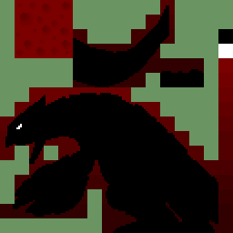

# Ruby public graphics

This page is generated from the repository's verified `graphics/` tree. Japanese and Korean assets are listed before English and other official languages.

## Header

| Preview | File | Language | Size | SHA-256 |
| --- | --- | --- | --- | --- |
|  | [`graphics/header/nintendo-logo-jp.png`](graphics/header/nintendo-logo-jp.png) | Japanese | 416x64 | `f07daf6e489d64b7...` |

## Title

| Preview | File | Language | Size | SHA-256 |
| --- | --- | --- | --- | --- |
|  | [`graphics/title/groudon-dark-en.png`](graphics/title/groudon-dark-en.png) | English | 256x256 | `2bd83dbd13c4827e...` |
|  | [`graphics/title/groudon-dark-de.png`](graphics/title/groudon-dark-de.png) | German | 256x256 | `2bd83dbd13c4827e...` |
|  | [`graphics/title/groudon-dark-fr.png`](graphics/title/groudon-dark-fr.png) | French | 256x256 | `2bd83dbd13c4827e...` |
|  | [`graphics/title/groudon-dark-it.png`](graphics/title/groudon-dark-it.png) | Italian | 256x256 | `2bd83dbd13c4827e...` |
|  | [`graphics/title/groudon-dark-es.png`](graphics/title/groudon-dark-es.png) | Spanish | 256x256 | `2bd83dbd13c4827e...` |
|  | [`graphics/title/groudon-dark-swatch.png`](graphics/title/groudon-dark-swatch.png) | Unspecified | 256x16 | `64e363c00272a110...` |
|  | [`graphics/title/groudon-dark.png`](graphics/title/groudon-dark.png) | Unspecified | 256x256 | `2bd83dbd13c4827e...` |

| Palette | Language | Colors | SHA-256 |
| --- | --- | --- | --- |
| [`graphics/title/groudon-dark.pal`](graphics/title/groudon-dark.pal) | Unspecified | 16 | `c755a5fef1e0a6d9...` |

Every entry is tied to at least one existing analysis or manifest record. Full hashes and provenance links are in `analysis/public-graphics-catalog.json`.
